# termind

**Schlanke, selbst hostbare Terminbuchung mit eingebauter KI-Schnittstelle (MCP).**
Eine ruhige Alternative zu Calendly & Co.: eine Instanz pro Person oder kleinem Team, alle Daten in einer SQLite-Datei auf deinem Server, rund 45 MB Arbeitsspeicher.

*English: termind is a lightweight, self-hostable scheduling tool (Calendly alternative) with a built-in MCP server so AI assistants can manage bookings. Single container, SQLite, ~45 MB RAM. Booking pages and emails in German and English, admin UI in German. AGPL-3.0.*

<p align="center">
  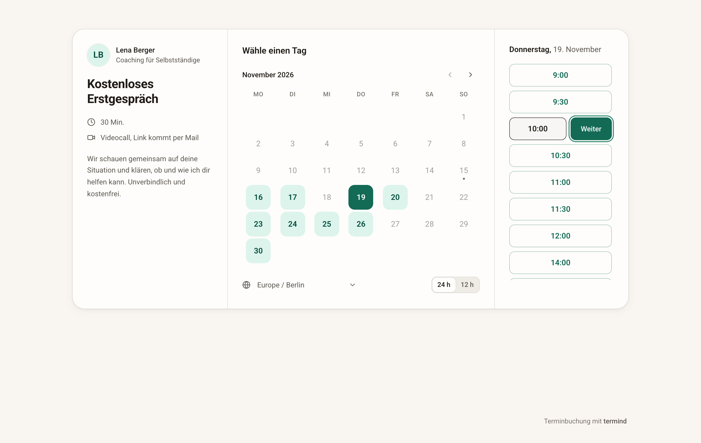
</p>

---

## Screenshots

| Buchung für Gäste | Verwaltung |
| --- | --- |
| 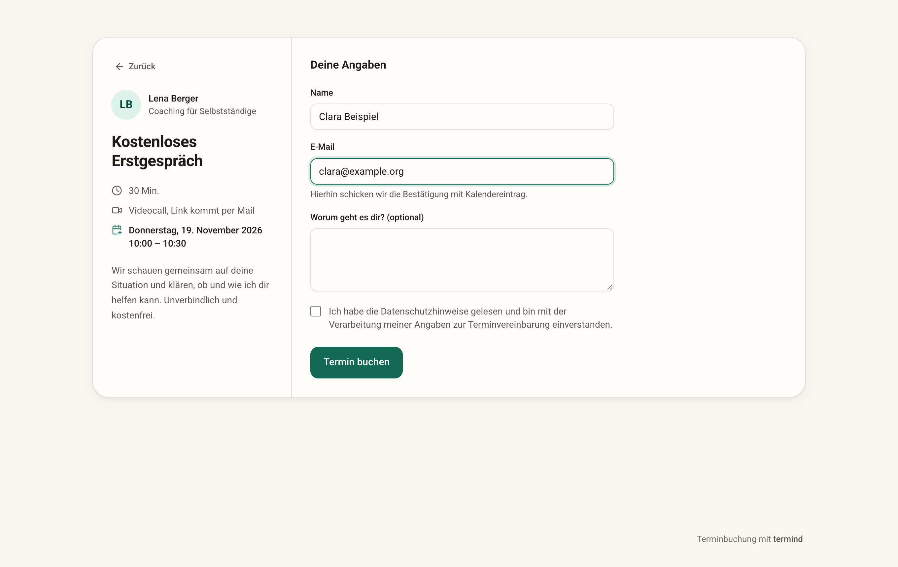 | 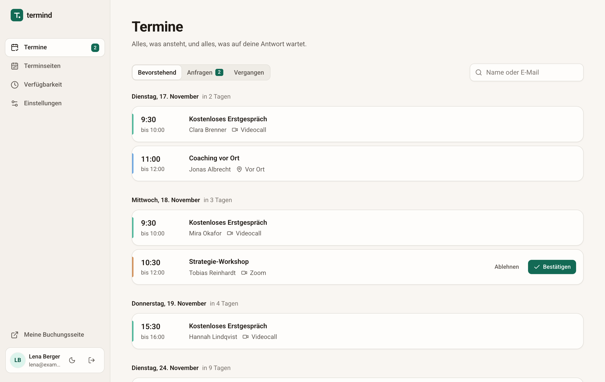 |
| 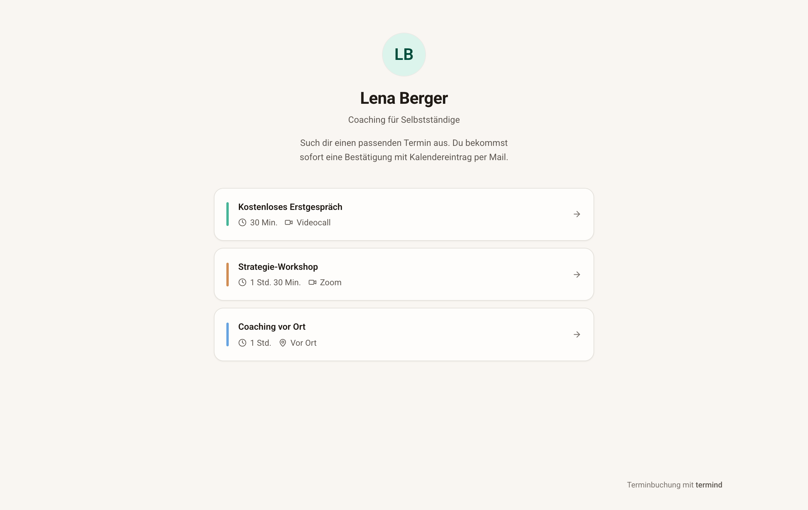 | 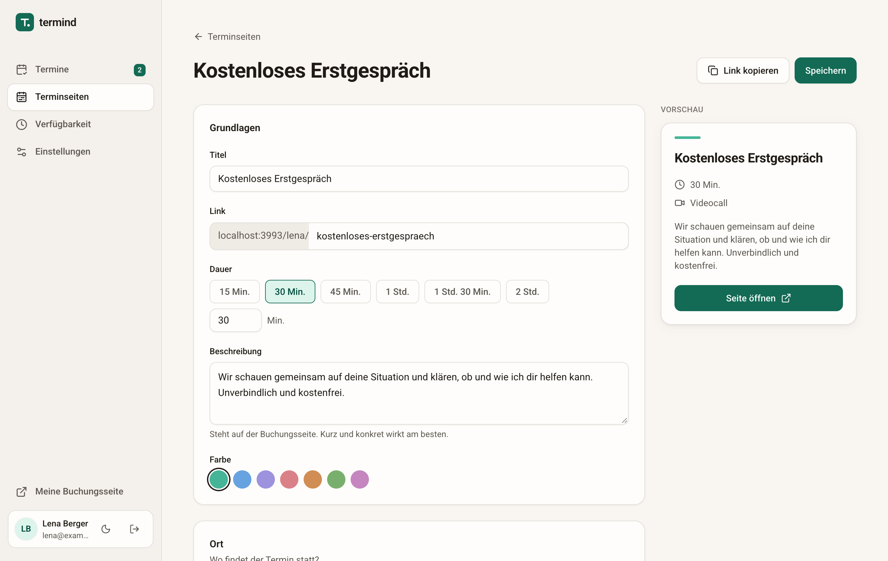 |
| 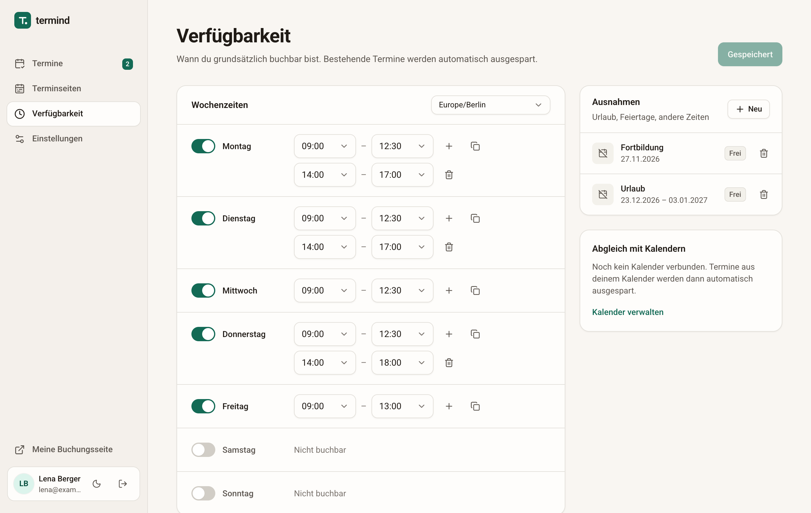 | 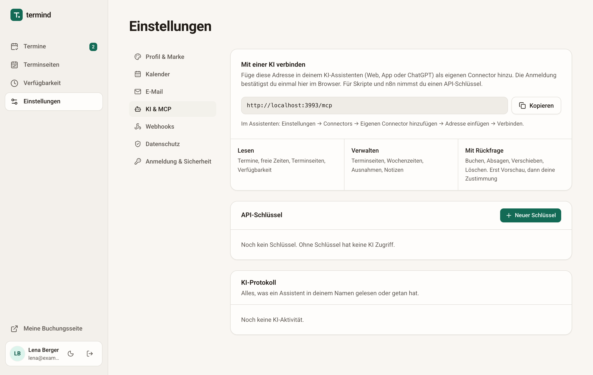 |
| 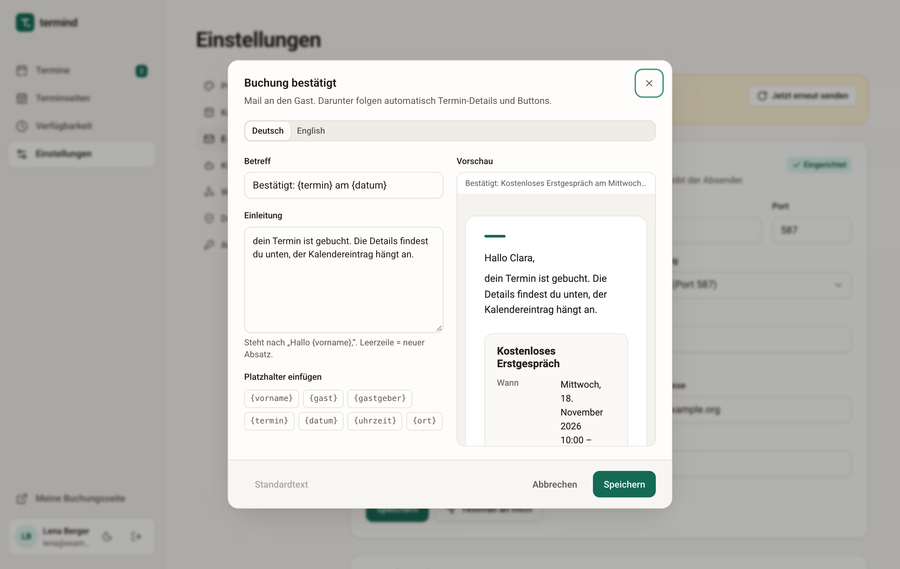 | 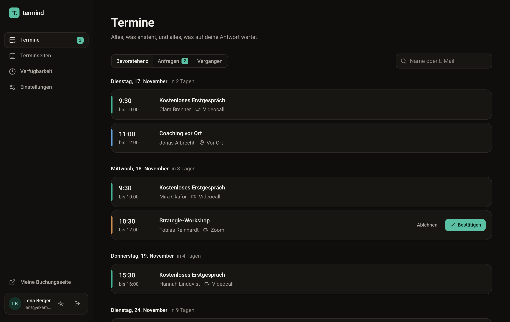 |

<p align="center">
  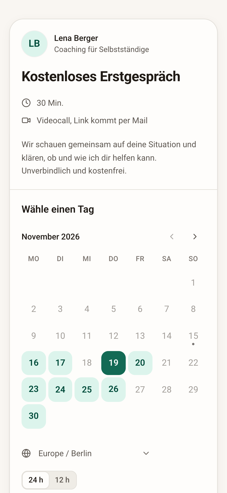
  &nbsp;&nbsp;
  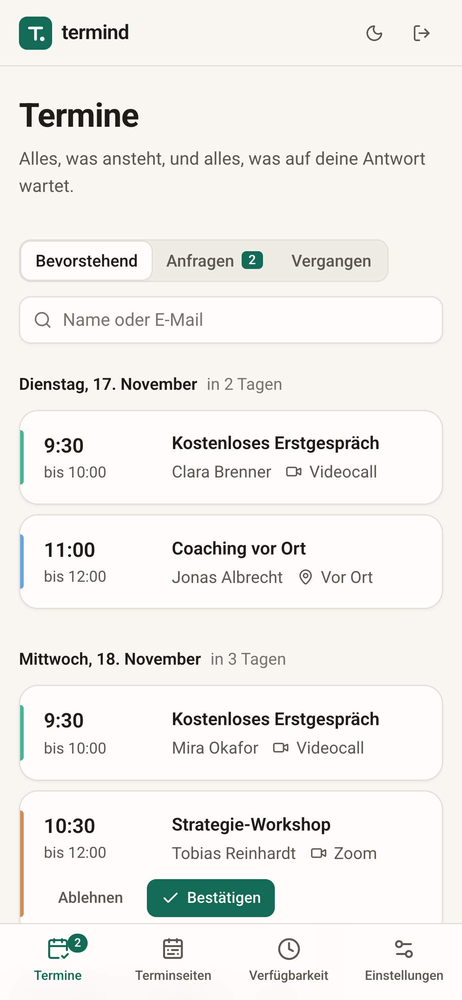
</p>

**Ausführliche Anleitung:** [docs/ANLEITUNG.md](docs/ANLEITUNG.md)

---

## Was termind kann

- **Buchungsseiten** mit Monatskalender, freien Zeiten in der Zeitzone des Gastes, eigenen Formularfeldern, Einwilligung und Bestätigung. Deutsch und Englisch.
- **Terminseiten** mit Dauer, Ort (Videolink, eigener Raum pro Termin, vor Ort, Telefon), Puffern, Mindestvorlauf, Buchungsfenster, Raster und optionaler Bestätigung durch dich.
- **Verfügbarkeit** mit mehreren Zeitfenstern pro Tag, Urlaub und abweichenden Tagen.
- **Kalender-Abgleich** mit Nextcloud, iCloud, mailbox.org, Fastmail & jedem CalDAV-Server (lesen und Termine eintragen) sowie ICS-Abos (Google, Outlook, Proton, nur lesen).
- **E-Mails über dein eigenes SMTP**: Bestätigung, Anfrage, Erinnerung, Verschiebung, Absage, jeweils mit Kalenderdatei. Texte editierbar mit Live-Vorschau.
- **Gäste verschieben oder sagen ab** über einen persönlichen Link, ohne Konto.
- **Einbettung** in jede Webseite mit einer Zeile: im Text, als Button-Popup oder schwebend.
- **KI-Verwaltung per MCP**: KI-Assistenten lesen Termine, finden freie Zeiten, buchen, verschieben, pflegen Terminseiten. Alles, was Gäste erreicht oder etwas löscht, braucht erst deine Zustimmung im Chat. Jede Aktion steht im KI-Protokoll.
- **Webhooks** mit HMAC-Signatur für n8n, Make, Zapier.
- **Datenschutz**: keine Cookies und keine fremden Server für Gäste, automatische Anonymisierung nach Frist, Auskunft und Löschung auf Knopfdruck.
- **Sicherheit**: Passwort (Argon2id), Passkeys, Zwei-Faktor-Anmeldung, verschlüsselte Zugangsdaten, strenge Sicherheits-Header.

## Schnellstart (ein Server, eigene Domain)

Voraussetzung: ein kleiner Linux-Server (1 vCPU, 512 MB RAM reichen) mit Docker und eine Domain, die auf ihn zeigt.

```bash
git clone https://github.com/gh-samk/termind.git
cd termind/deploy/single
cp .env.example .env        # DOMAIN und ACME_EMAIL eintragen
docker compose up -d
```

Caddy holt das HTTPS-Zertifikat automatisch. Den **Einrichtungslink** findest du im Log:

```bash
docker compose logs termind | grep setup
```

Nur mit diesem Link lässt sich das erste Konto anlegen, damit niemand Fremdes eine frische Instanz übernimmt. Anschließend unter *Einstellungen → E-Mail* dein Postfach eintragen und die erste Terminseite anlegen.

### Konfiguration

| Variable | Bedeutung | Standard |
| --- | --- | --- |
| `PUBLIC_URL` | Öffentliche Adresse mit `https://` (Links in Mails, Passkeys, OAuth) | `http://localhost:3000` |
| `TRUST_PROXY` | `true` hinter einem eigenen Reverse-Proxy (für korrekte Client-IP) | `false` |
| `DATA_DIR` | Datenbank, Schlüssel und Backups | `/data` |
| `BACKUP_HOURS` / `BACKUP_KEEP` | Automatisches Backup alle n Stunden, Anzahl behaltener Kopien (`0` = aus) | `24` / `7` |
| `CALENDAR_SYNC_MINUTES` | Abstand des Kalender-Abgleichs | `5` |
| `ALLOW_PRIVATE_HOSTS` | `true` erlaubt Kalender/Webhooks im lokalen Netz (z. B. Nextcloud im LAN) | `false` |
| `APP_SECRET` | Eigener Schlüssel für gespeicherte Passwörter, mind. 16 Zeichen (sonst wird `secret.key` erzeugt) | – |
| `SETUP_TOKEN` | Eigener Einrichtungsschlüssel (sonst wird einer erzeugt und ins Log geschrieben) | – |

### Backups

termind legt täglich eine konsistente Kopie unter `/data/backups` an. Manuell:

```bash
docker compose exec termind node server/index.js backup
```

Zum Wiederherstellen den Container stoppen, die Datei als `/data/termind.db` zurückkopieren und `termind.db-wal`/`-shm` löschen. **Sichere zusätzlich `/data/secret.key`**: ohne ihn sind gespeicherte Passwörter (SMTP, CalDAV) nach einer Wiederherstellung auf einem anderen Server nicht lesbar.

## Viele Instanzen betreiben (Hosting für Kunden)

`deploy/cloud/termind-cloud.sh` verwaltet beliebig viele, sauber getrennte Instanzen hinter einem gemeinsamen Caddy:

```bash
sudo ./termind-cloud.sh init admin@example.de
sudo ./termind-cloud.sh create kunde1 termine.kunde1.de   # gibt den Einrichtungslink für den Kunden aus
sudo ./termind-cloud.sh list
sudo ./termind-cloud.sh update --all
sudo ./termind-cloud.sh backup --all          # mit RCLONE_REMOTE auch extern
sudo ./termind-cloud.sh restore kunde1 kunde1-20270101T030000Z.tar.gz
sudo ./termind-cloud.sh delete kunde1
```

Jede Instanz läuft mit eigener Datenbank, Speicher-, CPU- und Prozesslimit, schreibgeschütztem Dateisystem und ohne Linux-Capabilities. Backups enthalten Datenbank und Schlüssel, vor jedem Update wird automatisch gesichert.

## KI anbinden (MCP)

Endpunkt: `https://DEINE-DOMAIN/mcp` (Streamable HTTP).

- **KI-Assistenten mit Connector-Unterstützung (Web, App, ChatGPT):** Adresse als eigenen Connector hinzufügen. Die Anmeldung läuft über OAuth 2.1, du bestätigst sie einmal im Browser und wählst *Nur lesen* oder *Verwalten*.
- **Desktop-Clients, Entwickler-Werkzeuge, n8n, Skripte:** unter *Einstellungen → KI & MCP* einen API-Schlüssel erstellen und als `Authorization: Bearer tmd_…` mitsenden.

API-Schlüssel und OAuth-Zugänge gelten **nur am MCP-Endpunkt**, nicht für die Admin-Oberfläche. Sicherheitseinstellungen (Passwort, Passkeys, Zwei-Faktor, neue Schlüssel) lassen sich nur von dir selbst in der Oberfläche ändern.

```json
{
  "mcpServers": {
    "termind": {
      "command": "npx",
      "args": ["-y", "mcp-remote", "https://termine.example.de/mcp", "--header", "Authorization: Bearer tmd_…"]
    }
  }
}
```

Werkzeuge u. a.: `get_overview`, `find_free_slots`, `list_bookings`, `book_appointment`, `reschedule_booking`, `cancel_booking`, `create_event_type`, `update_weekly_hours`, `add_exception`, `update_mail_text`, `export_personal_data`. Aktionen mit Gastkontakt, Datenabfluss (Webhooks) oder Löschen sowie Änderungen an Mail-Texten und Orten liefern zuerst eine Vorschau und laufen erst mit `confirm_action`.

> **Hinweis zu Prompt-Injection:** Namen und Antworten von Gästen sind fremde Eingaben. termind kennzeichnet sie für die KI als Daten, doch keine KI ist dagegen völlig immun. Lies die Vorschau, bevor du einer Aktion zustimmst, und gib Assistenten, die nur lesen sollen, einen Lese-Schlüssel.

## Webseite einbinden

```html
<script src="https://termine.example.de/embed.js" defer></script>
<div data-termind="lena/erstgespraech"></div>
<!-- oder: <button data-termind="lena/erstgespraech" data-mode="popup">Termin buchen</button> -->
<!-- oder: <div data-termind="lena" data-mode="floating" data-label="Termin buchen"></div> -->
```

Optionale Attribute: `data-theme="light|dark"`, `data-lang="de|en"`, `data-color="#1d6f63"`. Nach einer Buchung feuert das Element das Ereignis `termind:booked` (nur mit dem Status, ohne Personendaten).

## Entwicklung

```bash
npm install
npm run dev          # Oberfläche: http://localhost:5173 (API läuft auf :3317)
npm test             # Terminberechnung, Kalender-Parser, SSRF-Schutz, OAuth
npm run typecheck
npm run build && docker build -t termind .
```

Aufbau: `server/` (Hono, Drizzle ORM, SQLite/libSQL, Mail-Warteschlange, MCP, OAuth), `web/` (React, Vite, Tailwind), `shared/` (Typen und Schemas für beide Seiten), `deploy/` (Betrieb). Oberfläche, REST-API und MCP nutzen dieselbe Service-Schicht in `server/services/`, deshalb gelten alle Regeln überall gleich.

## Sicherheit

Siehe [SECURITY.md](SECURITY.md). Sicherheitslücken bitte vertraulich melden, nicht als öffentliches Issue.

## Lizenz

[GNU Affero General Public License v3.0](LICENSE). Wer termind verändert und als Dienst anbietet, muss den geänderten Quellcode den Nutzern zugänglich machen.
